<h1 align="center">wsp</h1>

<p align="center"><strong>Orchestrate coding agents across computers and clouds.</strong></p>

<p align="center">
  <a href="#get-started">Get started</a> ·
  <a href="https://usewsp.com/docs">Documentation</a> ·
  <a href="#cloud-providers">Cloud providers</a> ·
  <a href="#architecture">Architecture</a> ·
  <a href="https://github.com/wsp-labs/wsp/releases">Releases</a>
</p>

Run Claude Code, Codex, OpenCode and Cursor with the tools and subscriptions you already use. Give each part of the work its own thread, on your computer, another computer or the cloud. Follow it from the first message to the reviewed result.

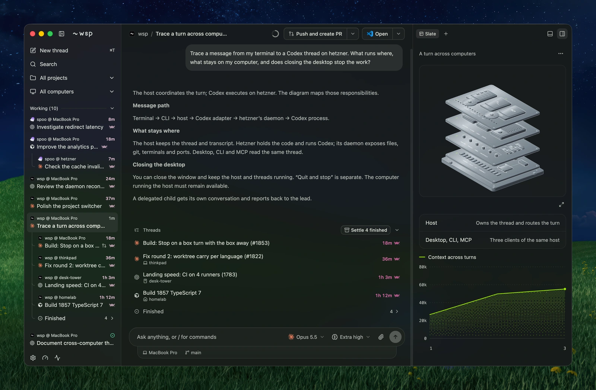

## Get started

```sh
curl -fsSL https://usewsp.com/install | sh
```

Open WSP, add a project, and start a thread with an agent you're signed in to.

**[Setup guide](https://usewsp.com/docs) · [Download the desktop app](https://github.com/wsp-labs/wsp/releases)**

<details>
<summary>Install the CLI with npm</summary>

With Node 22 or newer:

```sh
npm i -g @wsp-labs/wsp
```

</details>

Free and open source under AGPL-3.0. Agent subscriptions and cloud compute are billed separately.

## Delegate across computers

Keep an investigation local while another computer runs the tests. Use a different agent for the review. Every child has its own conversation, and its report returns to the lead.

<table>
<tr>
<td width="40%" valign="middle"><h3>One thread tree, several computers</h3><p>Claude Code, Codex, OpenCode and Cursor can hand work to each other across your connected computers. The sidebar keeps each child under the thread that started it.</p></td>
<td width="60%"><a href="docs/readme-assets/features/moss/orchestration.webp">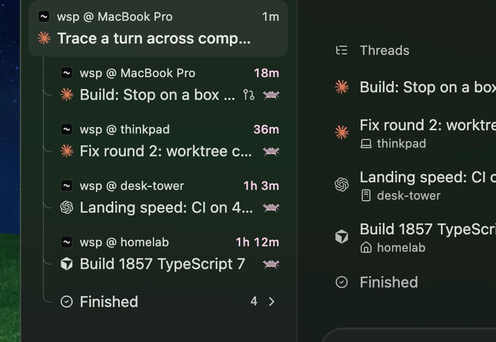</a></td>
</tr>
<tr>
<td width="40%" valign="middle"><h3>Your computer. Your setup.</h3><p>Connect a Linux computer over SSH and use its existing tools, or bring selected agents, sign-ins, CLIs, skills, MCP servers and shell settings. Save those choices as a recipe.</p></td>
<td width="60%"><a href="docs/readme-assets/features/moss/computers.webp">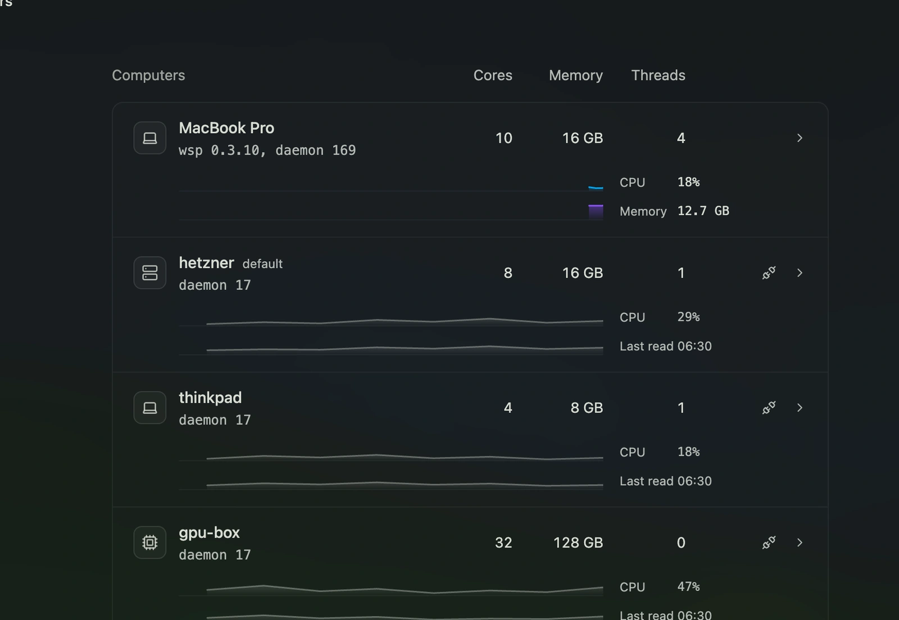</a></td>
</tr>
<tr>
<td width="40%" valign="middle"><h3>Your tools, on every computer</h3><p>Keep MCP servers, skills and plugins with the agents that use them. See what is available on each computer and manage it from the same panel.</p></td>
<td width="60%"><a href="docs/readme-assets/features/moss/tools.webp">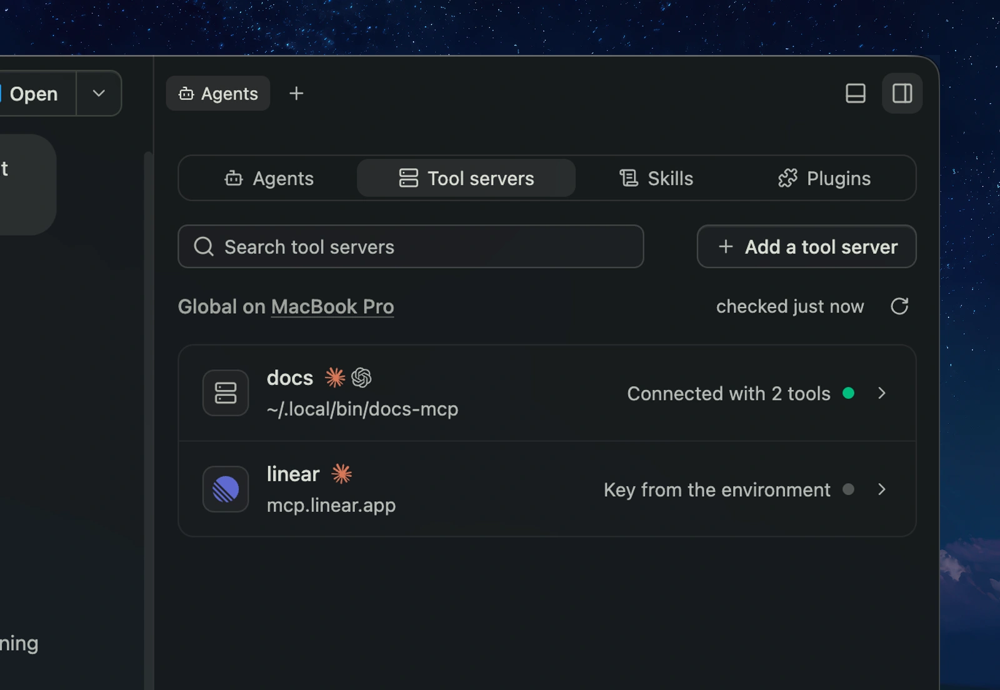</a></td>
</tr>
</table>


### Bring your setup with you

Choose the agents, MCP servers, command line tools, skills, projects and shell settings you want on a connected computer. WSP checks the computer and walks you through the setup.

<a href="docs/readme-assets/setup/setup-moss.gif">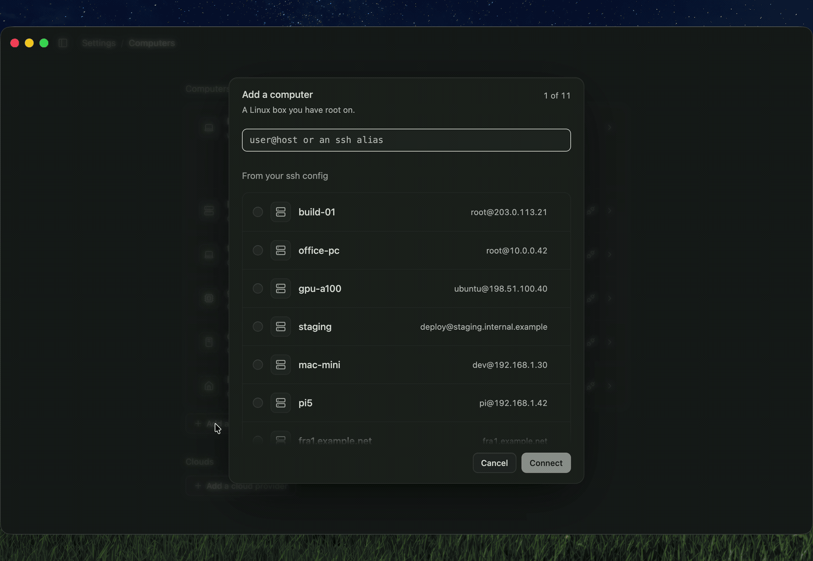</a>

### Cloud providers

Cloud execution currently requires a cloud-enabled build.

When work needs its own compute, launch a cloud child from your setup image. It starts from your pushed code on an independent branch. WSP manages capacity, spending limits and cleanup; the report and result come back for review.

<table>
<tr>
<td width="250" align="center"><a href="https://boat.dev"><br><strong>Boat</strong></a><br><sub>Available&nbsp;now</sub></td>
<td width="250" align="center"><a href="https://instabox.sh"><br><strong>Instabox</strong></a><br><sub>Coming&nbsp;soon</sub></td>
<td width="250" align="center"><a href="https://daytona.io"><br><strong>Daytona</strong></a><br><sub>Coming&nbsp;soon</sub></td>
<td width="250" align="center"><a href="https://celesto.ai"><br><strong>Celesto</strong></a><br><sub>Coming&nbsp;soon</sub></td>
</tr>
<tr>
<td width="250" align="center"><a href="https://freestyle.sh"><br><strong>Freestyle</strong></a><br><sub>Coming&nbsp;soon</sub></td>
<td width="250" align="center"><a href="https://e2b.dev"><br><strong>E2B</strong></a><br><sub>Coming&nbsp;soon</sub></td>
<td width="250" align="center"><a href="https://superserve.ai"><br><strong>Superserve</strong></a><br><sub>Coming&nbsp;soon</sub></td>
<td width="250" align="center"><a href="https://maritime.sh"><br><strong>Maritime</strong></a><br><sub>Coming&nbsp;soon</sub></td>
</tr>
</table>

## Follow the work

As threads multiply, WSP keeps the processes, usage and questions attached to the work that produced them.

<table>
<tr>
<td width="40%" valign="middle"><h3>Activity, down to the process</h3><p>See CPU, memory and listening ports across your computers. Follow a thread into its agent, MCP servers, builds and dev servers, including processes that outlive the shell that started them.</p></td>
<td width="60%"><a href="docs/readme-assets/features/moss/activity.webp">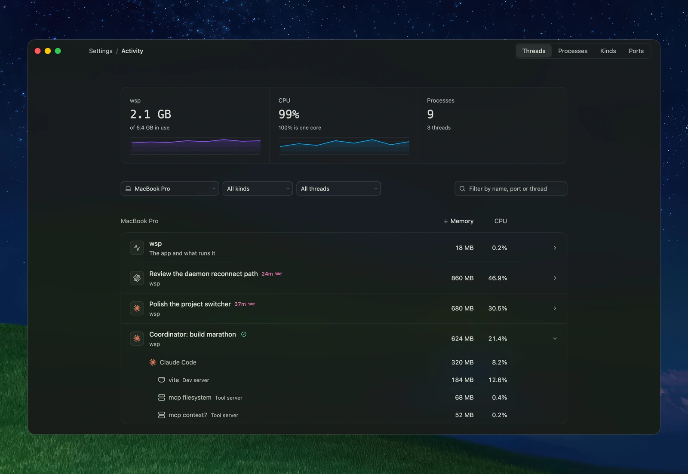</a></td>
</tr>
<tr>
<td width="40%" valign="middle"><h3>Usage across your accounts</h3><p>Track tokens, cache usage and API cost estimates by agent, account, computer, project or model. Check subscription limits and reset times before starting more work.</p></td>
<td width="60%"><a href="docs/readme-assets/features/moss/usage.webp">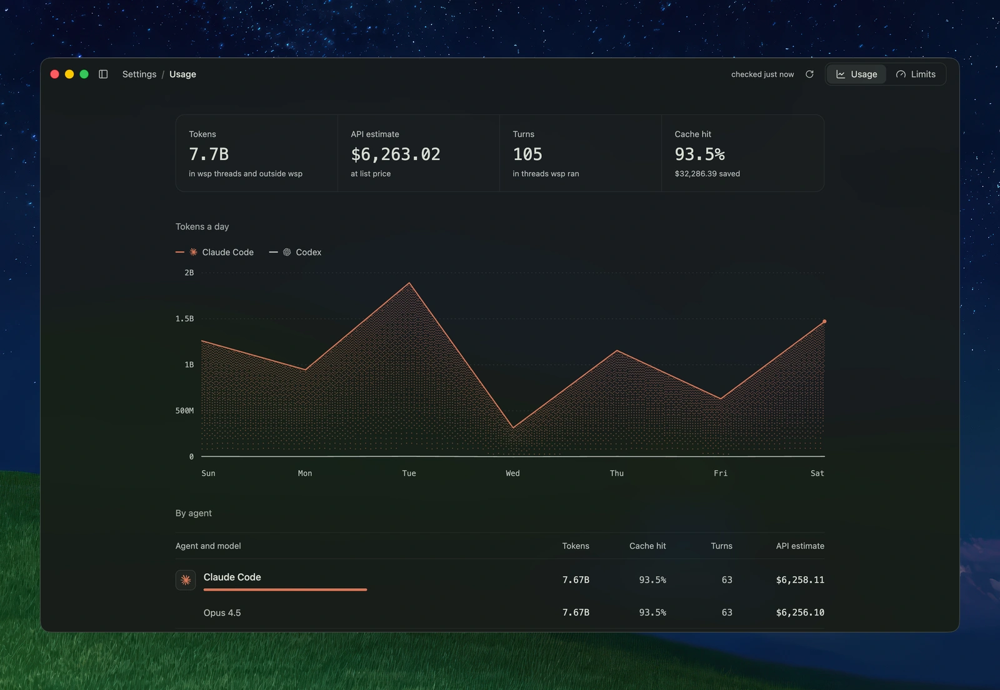</a></td>
</tr>
<tr>
<td width="40%" valign="middle"><h3>Resume when your limit resets</h3><p>A usage limit can pause a long task. Choose <strong>Resume at reset</strong>, and WSP continues the thread when the agent’s reported window resets.</p></td>
<td width="60%"><a href="docs/readme-assets/features/moss/resume-reset.webp">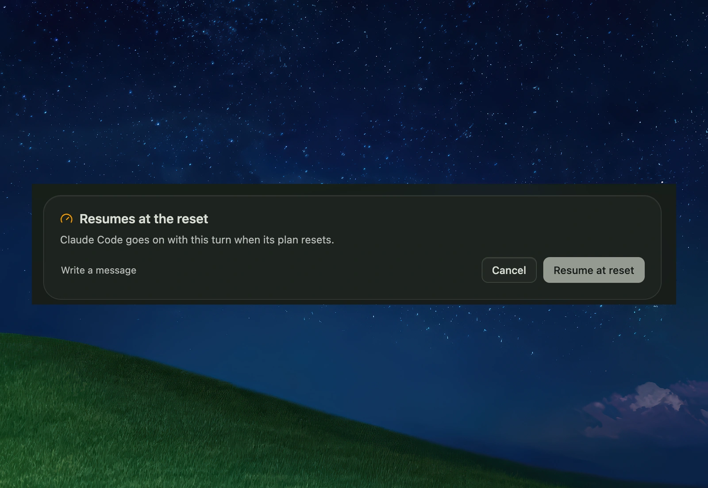</a></td>
</tr>
</table>

## Give the thread a live view

<table>
<tr>
<td width="40%" valign="middle"><h3>Slate, built for the work</h3><p>An architecture diagram for a review. A live chart for an investigation. A plan you can edit.<br><br>Agents build Slates beside their conversations. Panels can read current state, refresh without another agent turn, and send your edits and actions back to the agent.</p></td>
<td width="60%"><a href="docs/readme-assets/features/moss/slate-stack.webp">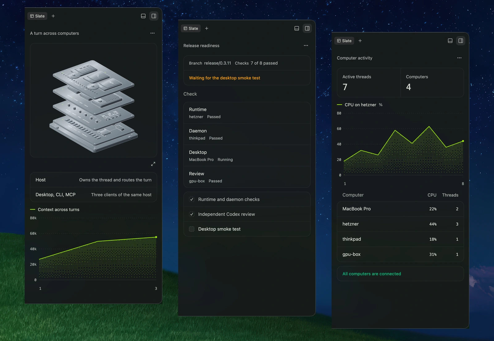</a></td>
</tr>
</table>

## Build and review where the work runs

The same tools follow the thread onto your connected computers and cloud compute.

<table>
<tr>
<td width="40%" valign="middle"><h3>A terminal on any computer</h3><p>Open a terminal in the thread’s project folder, locally or remotely. Your configured terminal font, colours and transparency come with it.</p></td>
<td width="60%"><a href="docs/readme-assets/features/moss/terminal.webp">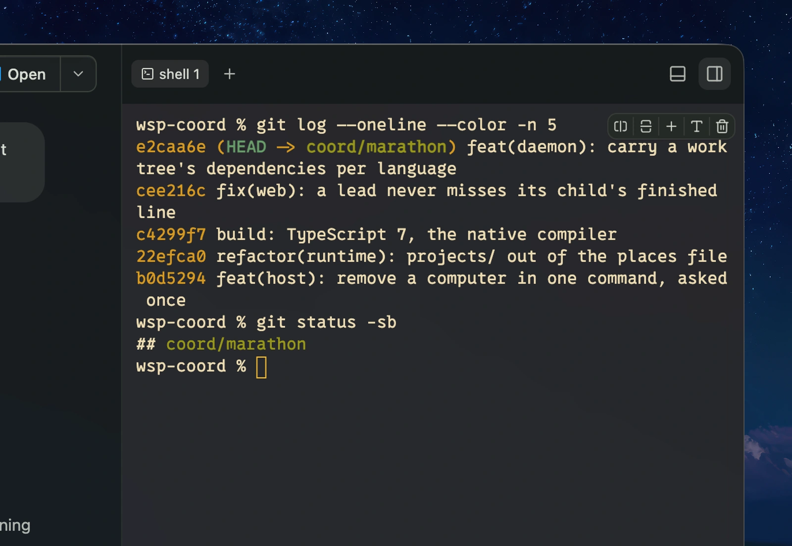</a></td>
</tr>
<tr>
<td width="40%" valign="middle"><h3>Preview the running application</h3><p>Open the dev server beside its thread. Browser access and port forwarding bring services on connected computers and cloud compute to your desktop.</p></td>
<td width="60%"><a href="docs/readme-assets/features/moss/browser.webp">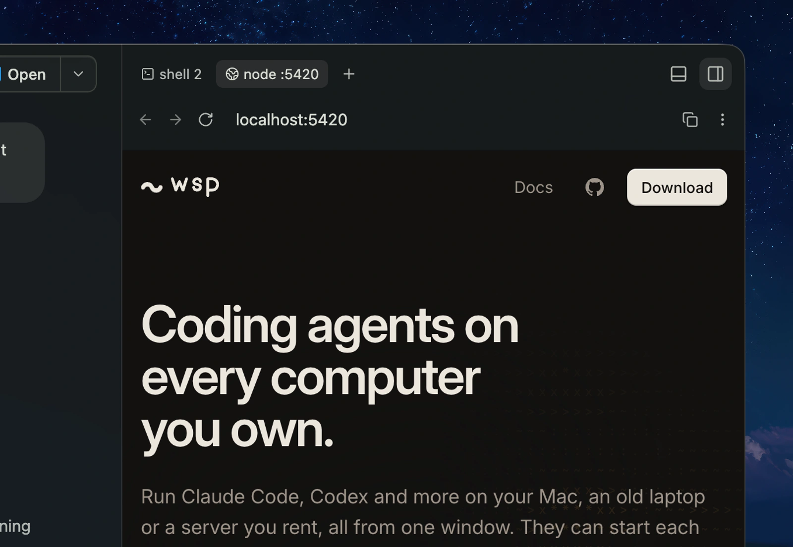</a></td>
</tr>

<tr>
<td width="40%" valign="middle"><h3>Review every change</h3><p>Inspect changed files and compare code diffs on the computer where the thread runs.</p></td>
<td width="60%"><a href="docs/readme-assets/features/moss/changes.webp">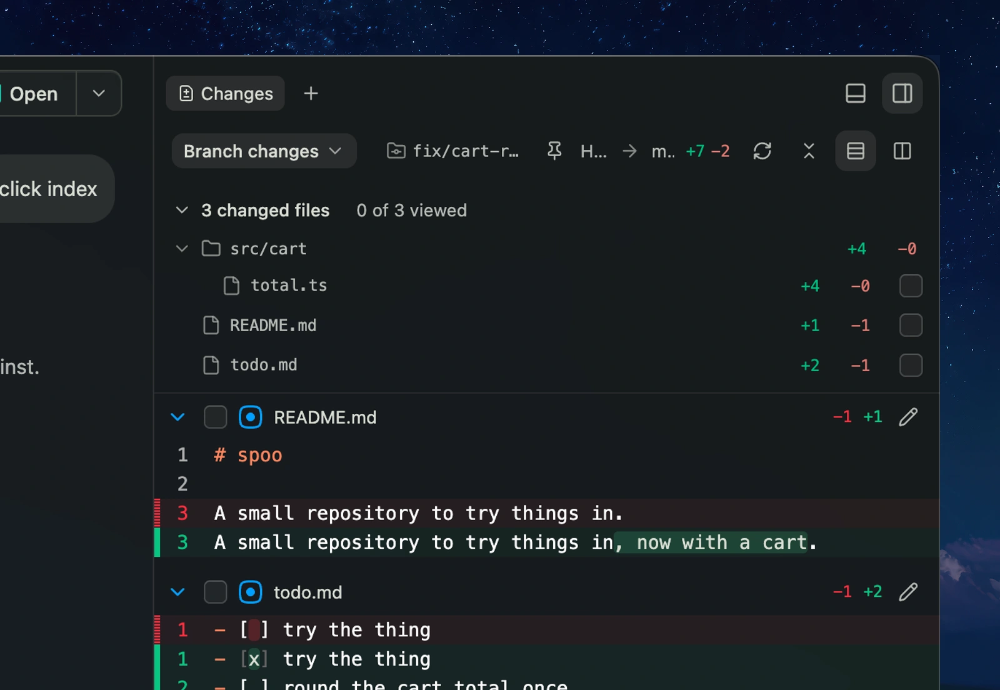</a></td>
</tr>
<tr>
<td width="40%" valign="middle"><h3>The pull request, beside the thread</h3><p>Review the PR, follow checks and inspect review feedback without leaving WSP. Send a failed check back to the agent.</p></td>
<td width="60%"><a href="docs/readme-assets/features/moss/pr.webp">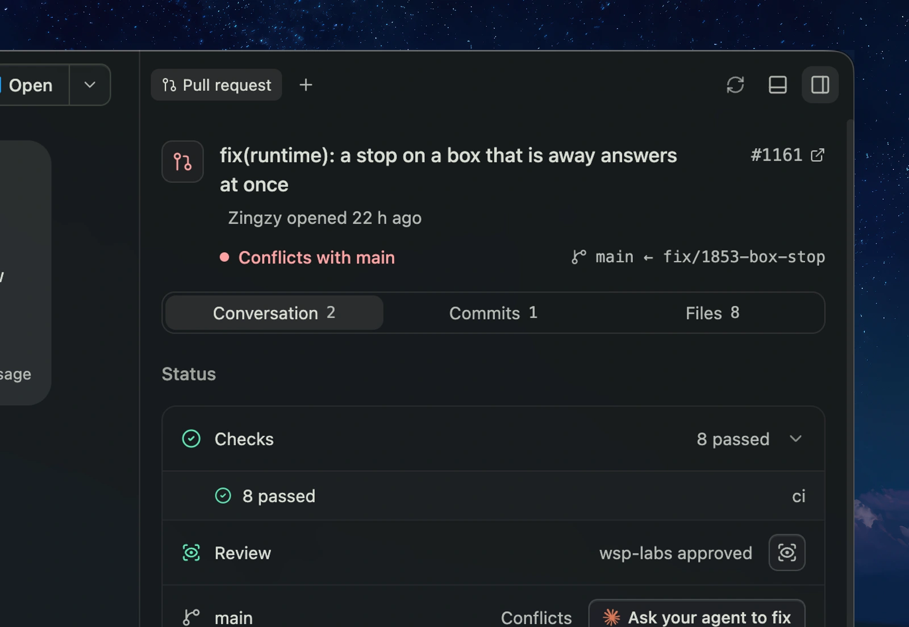</a></td>
</tr>
<tr>
<td width="40%" valign="middle"><h3>Open in your editor</h3><p>Continue in Zed, VS Code or Cursor. Supported editors open the thread’s folder over SSH when it lives on another computer.</p></td>
<td width="60%"><a href="docs/readme-assets/features/moss/editor.webp">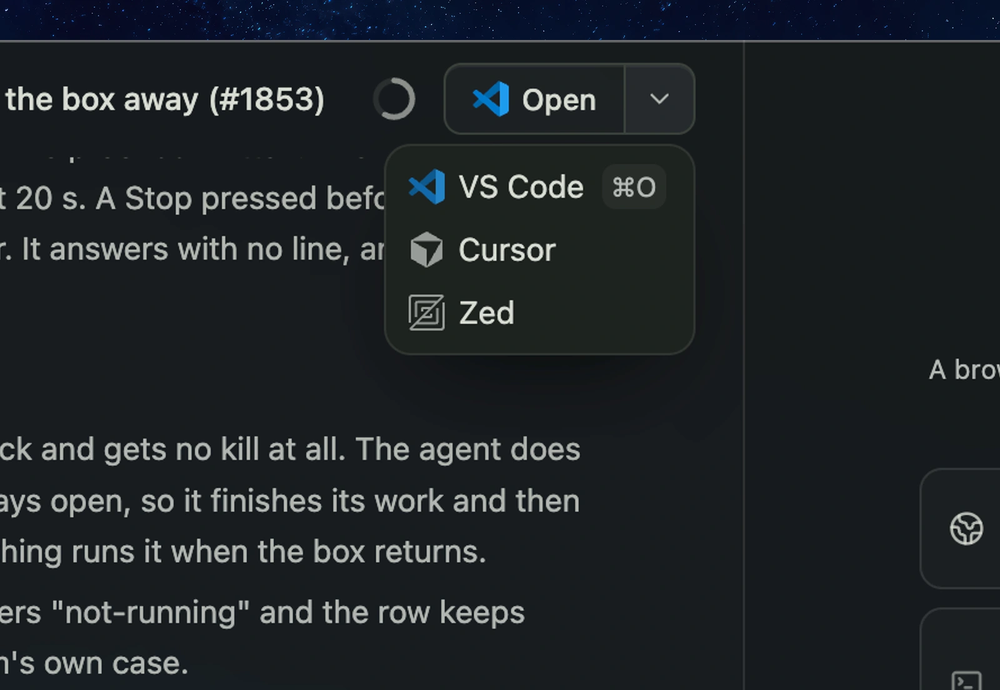</a></td>
</tr>
<tr>
<td width="40%" valign="middle"><h3>Ask a side question</h3><p>Use <code>/btw</code> in a Claude Code or Codex thread. The answer opens beside the work without adding to the main conversation.</p></td>
<td width="60%"><a href="docs/readme-assets/features/moss/btw.webp">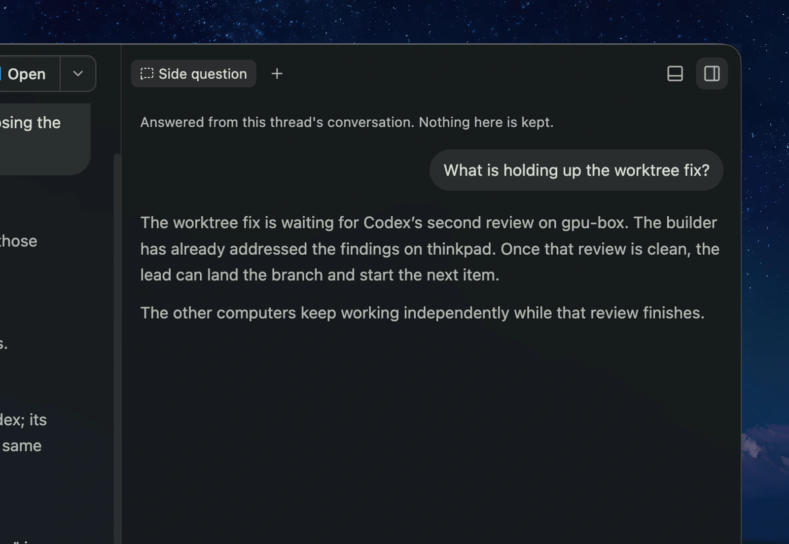</a></td>
</tr>
</table>

## Start from any surface

Desktop, CLI and MCP connect to the same persistent host. Start from your terminal or an agent you already use, then open WSP to follow the same threads.

<p>
 &nbsp;
 &nbsp;
 &nbsp;

</p>

**From your agent**

> Use WSP to ask Codex on gpu-box to review this change. Run the tests on hetzner and bring both reports back here.

**From your terminal**

```sh
wsp run wsp "Run the test suite" --on hetzner --agent codex
```

[MCP reference](https://usewsp.com/docs/reference/mcp-tools) · [CLI reference](https://usewsp.com/docs/reference/cli)

## Built around a persistent host
<a id="architecture"></a>

The **host** holds projects, threads and transcripts independently of the client. WSP’s **orchestration runtime** drives each agent’s own harness, preserves its conversation, routes messages and reports, and tracks each turn.

Each execution computer runs a **Rust daemon** for files, Git, terminals, ports and process activity. A connected computer needs the daemon and your tools; the desktop renders locally.

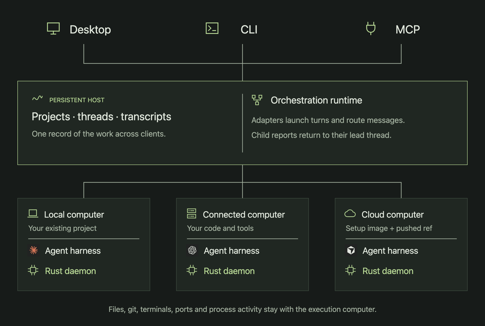

The daemon shares one process sampler between subscribers. It starts when needed, stops after the last subscriber leaves, and sends changes after the initial snapshot. Linux thread cgroups keep builds and dev servers attributed to their work after the original shell exits.

<details>
<summary><strong>Thread isolation, shared files and lifecycle</strong></summary>

<br>

| Execution location | Files | Conversation |
| --- | --- | --- |
| Same project folder | Shared working files | Separate per thread |
| Local worktree | Separate checkout and branch | Separate per thread |
| Connected computer | That computer's project folder | Separate per thread |
| Boat cloud child | Pushed starting ref; result branch | Separate per thread |

Delegation preserves the relationship between threads. It does not automatically copy the lead’s conversation or uncommitted edits. Conversation forking is an explicit operation where supported.

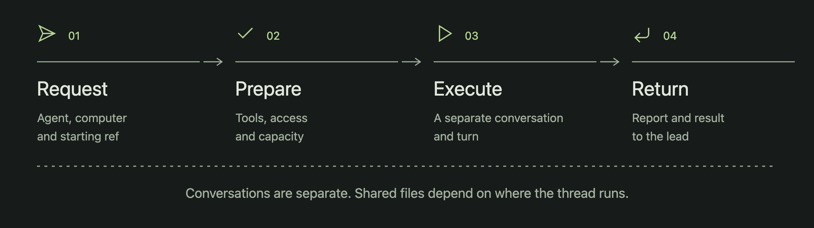

Closing a client, ending an agent turn and releasing cloud compute are separate events. The host keeps the record of the work across them.

</details>

### Native desktop beta

The native Rust desktop, built with GPUI, uses the same host and runtime. Our [port write-up](https://usewsp.com/blog/gpui-port/) covers the architecture and the October 27 comparison: **438 MiB in Electron to 180 MiB in GPUI** at rest, using the same conversations.

## Contributing

See [CONTRIBUTING.md](CONTRIBUTING.md) to build from source and contribute, or [report an issue](https://github.com/wsp-labs/wsp/issues).

## License

[AGPL-3.0-only](LICENSE) · [Third-party notices](THIRD_PARTY_NOTICES)
